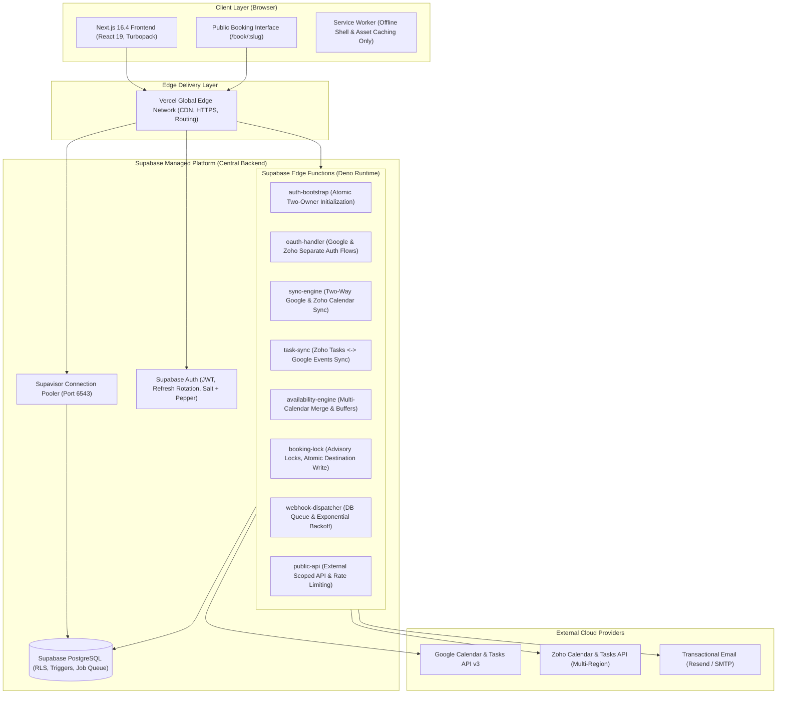
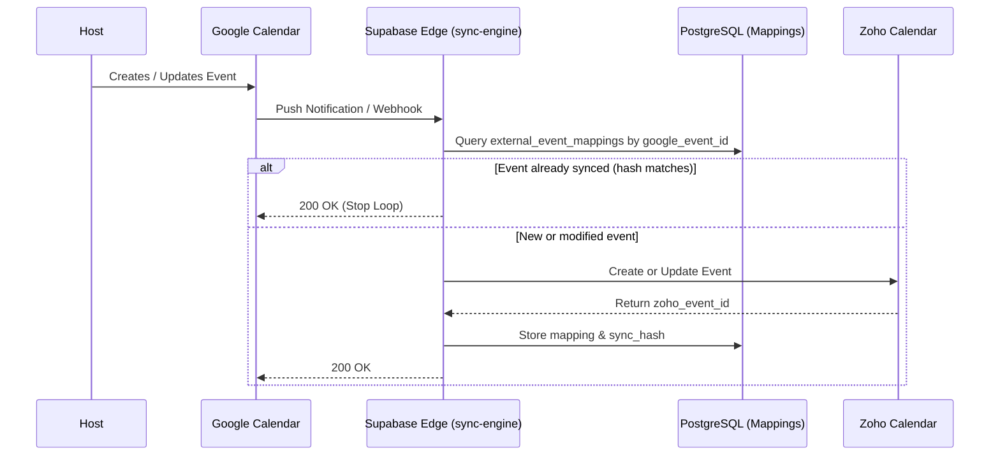
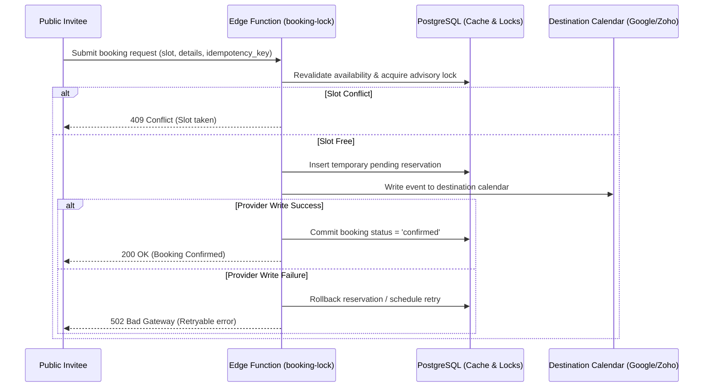

# Architecture · EG-Calendar · v3.0

## 1. System map

- **Next.js 16.4 Frontend:** Serves UI, form capture, optimistic state, and error boundaries.
- **Service Worker:** Browser-side offline application shell and static asset caching only.
- **Vercel Edge Network:** Edge routing, compression, and SSL termination.
- **Supabase Auth:** Issues JWTs, manages sessions, email verification, and token rotation.
- **Supabase PostgreSQL + RLS:** Multi-tenant storage, row-level security, triggers, and audit logs.
- **Supabase Edge Functions:** Trusted serverless execution for OAuth, two-way sync, conflict-free availability, booking locks, webhooks, and public APIs.
- **External Providers:** Google Calendar/Tasks, Zoho Calendar/Tasks, and Resend transactional email.

---

## 2. Responsibility rule
- **Frontend (Browser):** Display, collect user input, call validated API endpoints, handle loading/error states. Never executes business logic, never computes final availability, never verifies permissions, never stores OAuth tokens or service keys.
- **Backend (Supabase DB + Edge Functions):** All business logic, permission verification, availability slot calculations, row-level locks, two-way sync reconciliation, webhook queue retries, and API rate limiting.

---

## 3. Folder structure
```text
EG_calendar/
├── docs/                                 # 7 Approved System Design SOP documents
│   ├── prd.md
│   ├── architecture.md
│   ├── rules.md
│   ├── design.md
│   ├── performance.md
│   ├── task.md
│   └── memory.md
├── src/                                  # Next.js 16.4 Application Source
│   ├── app/                              # App Router route groups and layouts
│   │   ├── (auth)/                       # Login, Register, Approval Pending
│   │   ├── (workspace)/                  # Calendar, Links, Requests, Integrations, Settings
│   │   ├── api/                          # Next.js Server Handlers & Proxy Endpoints
│   │   │   └── v1/                       # Versioned internal & public endpoints
│   │   ├── book/                         # Public booking slug pages
│   │   └── platform-admin/               # Centralized Owner Administration Console
│   ├── components/                       # Shared UI and domain components
│   │   ├── ui/                           # Tokens-based design primitives
│   │   └── calendar/                     # Calendar grids and sync status widgets
│   ├── lib/                              # Supabase clients, utilities, validation schemas
│   └── public/                           # Static assets and browser service worker
├── supabase/                             # Supabase Infrastructure
│   ├── functions/                        # Deno-based Supabase Edge Functions
│   └── migrations/                       # PostgreSQL migrations & RLS policies
├── gemini.md                             # AI Development Guidance (Replacing CLAUDE.md)
├── AGENTS.md                             # Multi-Agent Workflow Instructions
└── .env.example                          # Environment configuration template
```

---

## 4. Data models (objects)

### owner_accounts
| Field | Type | Rules | Notes |
| id | uuid | pk, references auth.users(id) | Exactly 2 rows allowed |
| owner_number | integer | unique, check in (1, 2) | Enforced by DB trigger |
| email | text | unique, not null | Independent credentials |
| created_at | timestamptz | default now() | Atomic bootstrap |

### user_profiles & tenants
| Field | Type | Rules | Notes |
| id | uuid | pk, references auth.users(id) | User identity |
| organization_id | uuid | references organizations(id) | Tenant workspace |
| status | text | check in ('pending_approval', 'approved', 'rejected', 'suspended', 'disabled') | Approval lifecycle |
| role | text | check in ('owner', 'admin', 'member') | Tenant role |

### connected_accounts & connected_calendars
| Field | Type | Rules | Notes |
| id | uuid | pk | Calendar account |
| user_id | uuid | references auth.users(id) | Tenant owner |
| provider | text | check in ('google', 'zoho') | Provider type |
| encrypted_tokens | text | AES-GCM-256 | Kept server-side |
| sync_status | text | check in ('active', 'error', 'revoked') | Status |

### external_event_mappings (Two-Way Sync Engine)
| Field | Type | Rules | Notes |
| id | uuid | pk | Mapping record |
| user_id | uuid | references auth.users(id) | Tenant owner |
| google_event_id | text | indexed | Google calendar event ID |
| zoho_event_id | text | indexed | Zoho calendar event ID |
| sync_hash | text | not null | Prevents infinite sync loops |
| last_synced_at | timestamptz | default now() | Sync timestamp |

### task_event_mappings (Zoho Task <-> Google Event)
| Field | Type | Rules | Notes |
| id | uuid | pk | Task mapping record |
| user_id | uuid | references auth.users(id) | Tenant owner |
| zoho_task_id | text | indexed | Zoho Task ID |
| google_event_id | text | indexed | Mirrored Google event |
| deletion_policy | text | check in ('delete', 'cancel', 'keep') | Configurable policy |

### scheduling_profiles & scheduling_links
| Field | Type | Rules | Notes |
| id | uuid | pk | Profile / Link ID |
| user_id | uuid | references auth.users(id) | Host owner |
| working_hours | jsonb | not null | General working hours |
| booking_window | jsonb | not null | Specific booking window |
| expires_at | timestamptz | nullable | Expiration (UTC) |
| expiration_type | text | check in ('never', '1h', '24h', '7d', '30d', 'custom') | Universal expiration |

### bookings & cache_entries
| Field | Type | Rules | Notes |
| id | uuid | pk | Booking ID |
| status | text | check in ('pending', 'confirmed', 'cancelled', 'rescheduled') | Lifecycle |
| lock_key | text | unique | Concurrency advisory lock |
| cache_key | text | pk in cache_entries | TTL caching without Redis |
| expires_at | timestamptz | in cache_entries | Auto-purged via trigger |

---

## 5. API route map
Standard response envelope: `{ success: boolean, data?: any, error?: { code: string, message: string }, meta?: any }`

| Method | Route | Auth / Role | Request | Response | Errors |
| :--- | :--- | :--- | :--- | :--- | :--- |
| POST | /api/v1/auth/bootstrap-owners | Secret / Anon | { owner1, owner2 } | { success, data: { status } } | 400, 403, 409 |
| GET | /api/v1/owner/users?page=&limit= | Owner (1 or 2) | query params | { success, data: User[], meta } | 401, 403 |
| POST | /api/v1/owner/users/:id/status | Owner (1 or 2) | { status: 'approved'\|'rejected' } | { success, data: User } | 400, 403 |
| GET | /api/v1/integrations | Approved Member | None | { success, data: Account[] } | 401, 403 |
| POST | /api/v1/sync/reconcile | Approved Member | { provider } | { success, data: { synced } } | 400, 401 |
| GET | /api/v1/public/slots?slug=&date= | Public / Rate-limited | query params | { success, data: string[] } | 400, 404, 410, 429 |
| POST | /api/v1/public/book | Public / Idempotent | { slug, slot, invitee } | { success, data: Booking } | 400, 409, 410, 429 |
| POST | /api/v1/webhooks/subscribe | Scoped API Key | { url, events } | { success, data: Webhook } | 400, 401, 403 |
| GET | /api/v1/owner/monitoring?range= | Owner (1 or 2) | query params | { success, data: Metrics } | 401, 403 |

---

## 6. Auth and sessions
- **Supabase Auth:** Email/password and Google OAuth. Google Sign-In is isolated from Google Calendar scopes.
- **Refresh Tokens:** Stored in `httpOnly`, `Secure`, `SameSite=Lax` cookies; rotated on every call; revoked on logout.
- **Password Hashing:** Argon2id/bcrypt with per-user salt managed by Supabase Auth; backend pepper in secrets.
- **Protected Owners:** Exactly two accounts. Initialized via atomic RPC `bootstrap_owners()`. A database trigger forbids `INSERT` if `count >= 2`, forbids `DELETE` on either owner, and forbids role change.
- **Owner Password Workflow:** Requested via Settings -> Dispatches email security verification token -> Verified update -> Audited.

---

## 7. SEO data flow
`seo_meta` table -> `/api/v1/seo/:slug` -> Next.js `generateMetadata()` helper -> `<head>`, OpenGraph tags, JSON-LD (`ScheduleAction`, `Person`). SSR/SSG for public booking pages; workspace and admin routes strictly set `noindex, nofollow`.

---

## 8. State plan
- **Server Data:** TanStack React Query hooks with defined invalidation keys (`['slots', slug, date]`, `['requests']`, `['connections']`).
- **UI State:** Minimal React context / local state for modals, active drawer tabs, and mobile navigation toggles.

---

## 9. Error flow
Typed application error (`AppError`) -> Supabase Edge Function error handler -> Standard JSON envelope (`{ success: false, error: { code, message } }`) -> Client toast with "What Happened + What To Do" remediation message -> Route error boundary prevents white-screen crashes.

---

## 10. Integrations
| Provider | Direction | Auth Method | Timeout & Retries | Webhook Route |
| :--- | :--- | :--- | :--- | :--- |
| Google Calendar | Two-way | OAuth 2.0 (AES token) | 20s timeout, 2 backoff retries | /api/v1/webhooks/google |
| Zoho Calendar | Two-way | Multi-region OAuth 2.0 | 20s timeout, 2 backoff retries | /api/v1/webhooks/zoho |
| Zoho Tasks | Two-way | Zoho API OAuth 2.0 | 15s timeout, 2 backoff retries | Scheduled / Edge trigger |
| Resend Email | Outbound | API Key Bearer | 10s timeout, 3 retries | /api/v1/webhooks/email |

---

## 11. Environments and config
- **Environments:** `dev`, `staging` (noindex enforced), `production`.
- **Config:** `.env.example` lists all public and server environment variables. Secrets strictly stored in Supabase Vault and Vercel Environment Variables.

---

## 12. AI components
**None.** No AI models, prompts, or `ai-setup-guide.md` used.

---

## 13. Diagrams
### Request Flow 1: Two-Way Calendar Synchronization


### Request Flow 2: Zero-Conflict Atomic Booking Reservation

